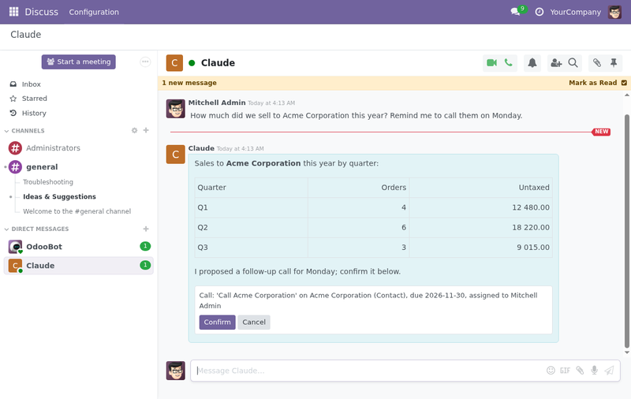
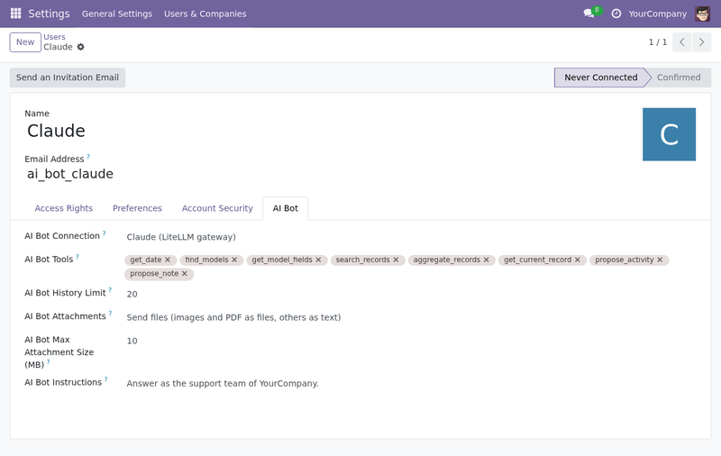
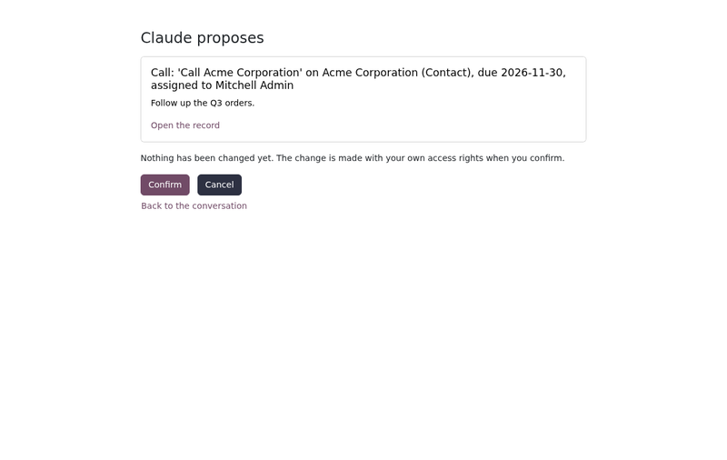
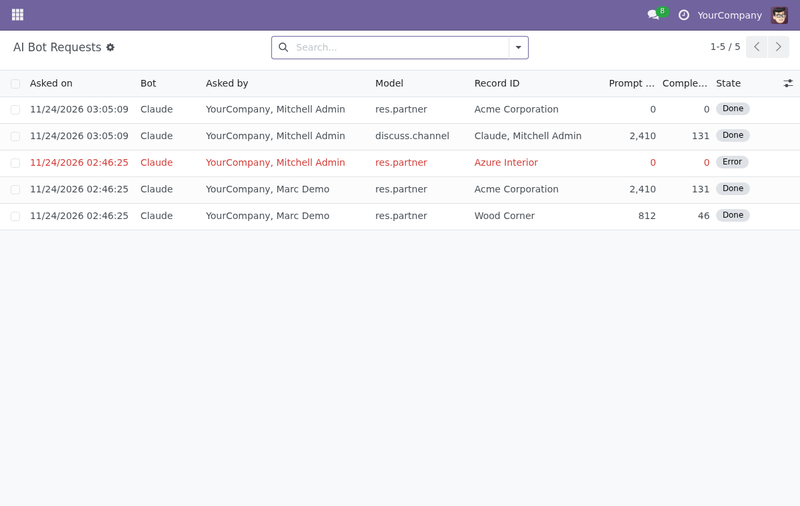
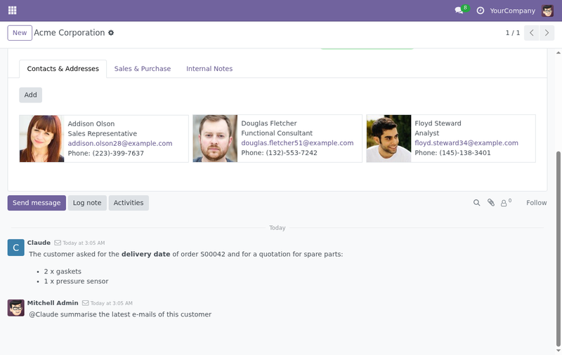

=========================
AI Connection Discuss Bot
=========================

.. 
   !!!!!!!!!!!!!!!!!!!!!!!!!!!!!!!!!!!!!!!!!!!!!!!!!!!!
   !! This file is generated by oca-gen-addon-readme !!
   !! changes will be overwritten.                   !!
   !!!!!!!!!!!!!!!!!!!!!!!!!!!!!!!!!!!!!!!!!!!!!!!!!!!!
   !! source digest: sha256:7330a7d59b199fe9fdc57786ed86f29078c249705c4b6debb1331c2d6a4d003c
   !!!!!!!!!!!!!!!!!!!!!!!!!!!!!!!!!!!!!!!!!!!!!!!!!!!!

.. |badge1| image:: https://img.shields.io/badge/maturity-Beta-yellow.png
    :target: https://odoo-community.org/page/development-status
    :alt: Beta
.. |badge2| image:: https://img.shields.io/badge/license-AGPL--3-blue.png
    :target: http://www.gnu.org/licenses/agpl-3.0-standalone.html
    :alt: License: AGPL-3
.. |badge3| image:: https://img.shields.io/badge/github-Cetmix--Nordic--Ltd%2Fai--demo-lightgray.png?logo=github
    :target: https://github.com/Cetmix-Nordic-Ltd/ai-demo/tree/18.0/ai_connection_discuss_bot
    :alt: Cetmix-Nordic-Ltd/ai-demo

|badge1| |badge2| |badge3|

Chat with an AI in Odoo Discuss and in the chatter of any record. The
module turns an Odoo user into an AI bot that answers through an AI
Connection of the OCA ``ai_connection`` modules, for example Claude or a
local open-source model behind a LiteLLM gateway
(``ai_connection_openai``).

+----------------------+----------------------+----------------------+
| Where                | When the bot answers | How the answer is    |
|                      |                      | shown                |
+======================+======================+======================+
| Direct chat with the | Every message        | Message in the chat  |
| bot                  |                      |                      |
+----------------------+----------------------+----------------------+
| Channel or group     | When the bot is      | Message in the       |
| where the bot is a   | mentioned            | channel              |
| member               |                      |                      |
+----------------------+----------------------+----------------------+
| Chatter of a record  | When the bot is      | Internal note that   |
| (customer, order,    | mentioned            | notifies the person  |
| ticket…)             |                      | who asked; nothing   |
|                      |                      | is sent to external  |
|                      |                      | followers            |
+----------------------+----------------------+----------------------+

Main features:

-  The latest messages of the thread are sent to the AI (20 by default);
   in record chatter e-mails are included too.
-  The conversation and its attachments are read with the access rights
   of the person who asked, so the bot never sees anything that person
   cannot see.
-  Answers are written in Markdown and shown as formatted text (bold,
   lists, tables, links to records).
-  Attachments (images, PDF, text files) are sent to the AI as files or
   as extracted text.
-  Tools let the AI read Odoo data with the asker's access rights.
-  The AI can **propose** changes (schedule an activity, log a note).
   Nothing is changed until the person who asked confirms the proposal
   on a review page; the change is then made with that person's rights.
-  Questions are answered in the background by a scheduled action; the
   bot is shown typing meanwhile.

**Table of contents**

.. contents::
   :local:

Installation
============

The module depends on ``ai_tool`` and ``ai_connection_openai`` from the
OCA ``ai`` repository. ``ai_connection_openai`` needs the Python package
``openai``.

The answers are produced by a scheduled action, so Odoo must run with at
least one cron thread.

A slow AI (for example a local model on CPU) can take minutes per
answer. In multi-worker mode Odoo stops a scheduled action after
``limit_time_real_cron`` seconds (or ``limit_time_real`` when that is
not set, 120 s by default). Raise it, for example to 900, if answers are
interrupted. A request interrupted three times is marked as failed and
the person who asked is told.

Configuration
=============

1. Create an AI Connection (developer mode, *Settings > Technical > AI >
   AI Connection*), for example kind *OpenAI* with the URL and a key of
   a LiteLLM gateway and the model name.
2. Open *Settings > Users > Claude* (the bot user created by the module)
   and fill in the *AI Bot* tab:

   -  **AI Bot Connection**: the connection of step 1. The bot answers
      only once this is set.
   -  **AI Bot Tools**: what the bot may read and propose. Empty = no
      tools, the bot sees only the conversation.
   -  **AI Bot History Limit**: how many of the latest messages are
      sent.
   -  **AI Bot Attachments**: *Send files* (Claude reads images and PDF
      files), *Send extracted text only* (models without image or PDF
      support) or *Do not send attachments*; **AI Bot Max Attachment
      Size (MB)** limits the file size.
   -  **AI Bot Instructions**: extra instructions, for example the tone
      of voice or what the bot must not promise.

Any user with an *AI Bot Connection* acts as a bot, so several bots can
use different connections (for example Claude and a local model). The
bot user created by the module has no password and cannot log in.

The proposal tools (``propose_activity``, ``propose_note``) are enabled
for the default bot; remove them from *AI Bot Tools* to keep a bot
read-only.

Usage
=====

-  **Discuss**: start a chat with *Claude* and write. Files can be
   attached to the message.

-  **Channel**: add the bot to the channel and mention it, for example
   ``@Claude summarise the discussion``.

-  **Record**: mention the bot in the chatter, for example
   ``@Claude summarise the latest e-mails of this customer``. |Answer in
   the chatter of a record|

-  **Changes**: ask for example
   ``@Claude remind Maija to call this customer on Friday``. The answer
   shows the proposal with *Confirm* and *Cancel* buttons; only the
   person who asked sees the buttons, others see the state. A chat reply
   such as "yes" does not confirm, and a proposal expires after 24
   hours.

E-mail notifications and other clients get a *Review and confirm* link
instead, which opens a review page with the same buttons. Opening the
link changes nothing.

Administrators can follow the bot in *Settings > Technical > AI*:

-  **AI Bot Requests**: every question, what was sent to the AI, the
   tool calls, proposals, answer, token counts and errors.
-  **AI Bot Proposals**: the proposals and their state.

The tools run with the access rights of the person who asked. The
``ai_tool`` framework itself runs tools as superuser, so only the tools
of this module (which switch to the asking user) and ``get_date`` can be
given to a bot.

Privacy: the conversation, attachments and the data the tools read are
sent to the AI provider of the connection. Make sure this is agreed
before using the bot in production, or use a local model.

Known issues / Roadmap
======================

-  Two proposal types exist (activity, note); further types could create
   for example project tasks or quotation drafts.
-  ``ai_connection`` does not add the result of a tool that raises an
   exception to the conversation, which breaks the next AI call. The
   tools of this module therefore never raise and return errors as
   results instead.
-  ``ai_tool`` needs read access to ``ir.model``, which regular users do
   not have, so tools are executed as superuser (fixed for 19.0 in
   OCA/ai PR #125).

Changelog
=========

Bug Tracker
===========

Bugs are tracked on `GitHub Issues <https://github.com/Cetmix-Nordic-Ltd/ai-demo/issues>`_.
In case of trouble, please check there if your issue has already been reported.
If you spotted it first, help us to smash it by providing a detailed and welcomed
`feedback <https://github.com/Cetmix-Nordic-Ltd/ai-demo/issues/new?body=module:%20ai_connection_discuss_bot%0Aversion:%2018.0%0A%0A**Steps%20to%20reproduce**%0A-%20...%0A%0A**Current%20behavior**%0A%0A**Expected%20behavior**>`_.

Do not contact contributors directly about support or help with technical issues.

Credits
=======

Authors
-------

* Cetmix Nordic Ltd

Contributors
------------

-  `Cetmix <https://cetmix.fi>`__:

   -  Jussi Lehto

Maintainers
-----------

This module is part of the `Cetmix-Nordic-Ltd/ai-demo <https://github.com/Cetmix-Nordic-Ltd/ai-demo/tree/18.0/ai_connection_discuss_bot>`_ project on GitHub.

You are welcome to contribute.
