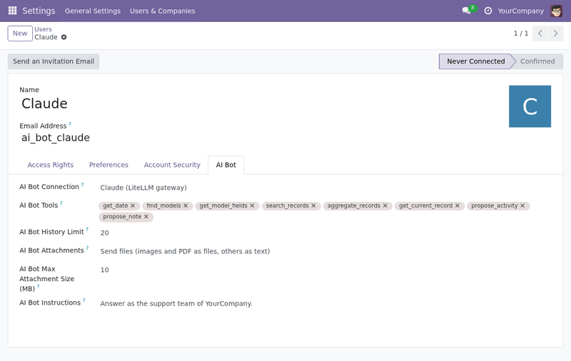

1.  Create an AI Connection (developer mode, *Settings \> Technical \>
    AI \> AI Connection*), for example kind *OpenAI* with the URL and a
    key of a LiteLLM gateway and the model name.
2.  Open *Settings \> Users \> Claude* (the bot user created by the
    module) and fill in the *AI Bot* tab:
    - **AI Bot Connection**: the connection of step 1. The bot answers
      only once this is set.
    - **AI Bot Tools**: what the bot may read and propose. Empty = no
      tools, the bot sees only the conversation.
    - **AI Bot History Limit**: how many of the latest messages are sent.
    - **AI Bot Attachments**: *Send files* (Claude reads images and PDF
      files), *Send extracted text only* (models without image or PDF
      support) or *Do not send attachments*;
      **AI Bot Max Attachment Size (MB)** limits the file size.
    - **AI Bot Instructions**: extra instructions, for example the tone
      of voice or what the bot must not promise.

Any user with an *AI Bot Connection* acts as a bot, so several bots can
use different connections (for example Claude and a local model). The
bot user created by the module has no password and cannot log in.

The proposal tools (`propose_activity`, `propose_note`) are enabled for
the default bot; remove them from *AI Bot Tools* to keep a bot
read-only.
