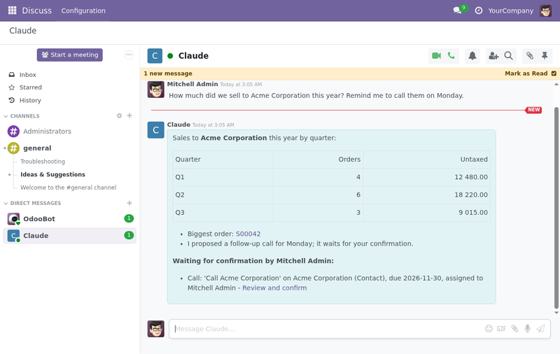

Chat with an AI in Odoo Discuss and in the chatter of any record. The
module turns an Odoo user into an AI bot that answers through an AI
Connection of the OCA `ai_connection` modules, for example Claude or a
local open-source model behind a LiteLLM gateway
(`ai_connection_openai`).

| Where | When the bot answers | How the answer is shown |
|---|---|---|
| Direct chat with the bot | Every message | Message in the chat |
| Channel or group where the bot is a member | When the bot is mentioned | Message in the channel |
| Chatter of a record (customer, order, ticket…) | When the bot is mentioned | Internal note that notifies the person who asked; nothing is sent to external followers |

Main features:

- The latest messages of the thread are sent to the AI (20 by
  default); in record chatter e-mails are included too.
- The conversation and its attachments are read with the access rights
  of the person who asked, so the bot never sees anything that person
  cannot see.
- Answers are written in Markdown and shown as formatted text (bold,
  lists, tables, links to records).
- Attachments (images, PDF, text files) are sent to the AI as files or
  as extracted text.
- Tools let the AI read Odoo data with the asker's access rights.
- The AI can **propose** changes (schedule an activity, log a note).
  Nothing is changed until the person who asked confirms the proposal on
  a review page; the change is then made with that person's rights.
- Questions are answered in the background by a scheduled action; the
  bot is shown typing meanwhile.
