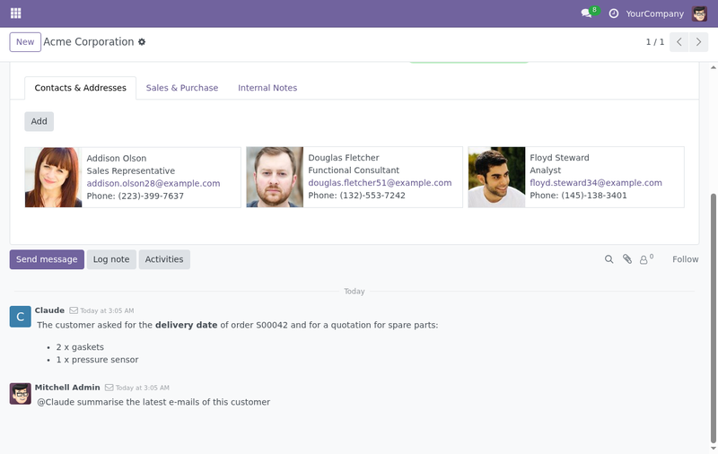
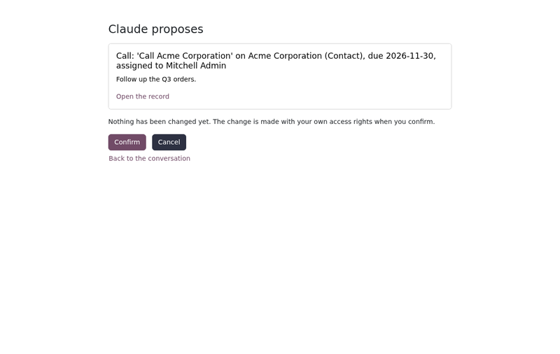
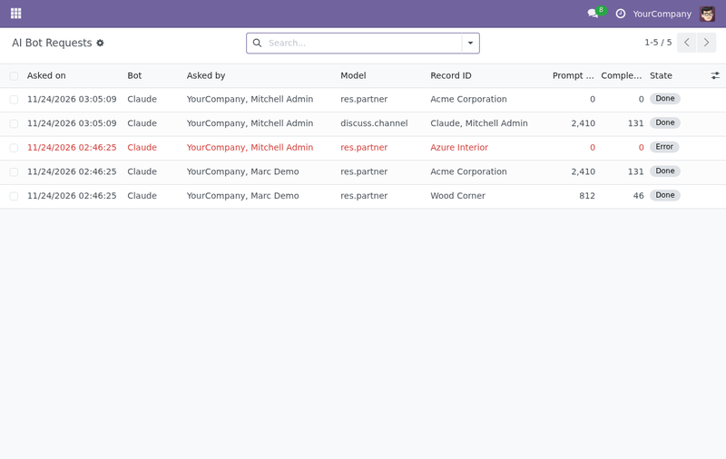

- **Discuss**: start a chat with *Claude* and write. Files can be
  attached to the message.
- **Channel**: add the bot to the channel and mention it, for example
  `@Claude summarise the discussion`.
- **Record**: mention the bot in the chatter, for example
  `@Claude summarise the latest e-mails of this customer`.

- **Changes**: ask for example `@Claude remind Maija to call this
  customer on Friday`. The answer shows the proposal with *Confirm* and
  *Cancel* buttons; only the person who asked sees the buttons, others
  see the state. A chat reply such as "yes" does not confirm, and a
  proposal expires after 24 hours.

E-mail notifications and other clients get a *Review and confirm* link
instead, which opens a review page with the same buttons. Opening the
link changes nothing.

Administrators can follow the bot in *Settings \> Technical \> AI*:

- **AI Bot Requests**: every question, what was sent to the AI, the
  tool calls, proposals, answer, token counts and errors.
- **AI Bot Proposals**: the proposals and their state.

The tools run with the access rights of the person who asked. The
`ai_tool` framework itself runs tools as superuser, so only the tools of
this module (which switch to the asking user) and `get_date` can be
given to a bot.

Privacy: the conversation, attachments and the data the tools read are
sent to the AI provider of the connection. Make sure this is agreed
before using the bot in production, or use a local model.

Troubleshooting:

- **Requests stay Pending and the AI gateway sees nothing**: the
  scheduled action *AI Discuss Bot: answer questions* does not run in
  this database. If *Run Manually* on the scheduled action answers,
  check *Apps* (remove the *Apps* filter, group by *Status*): Odoo runs
  no scheduled actions in a database where a module is *To Install*,
  *To Upgrade* or *To Remove*. Finish or cancel that change. Also check
  that the scheduled action is active and that the Odoo server runs
  scheduled actions for this database (`db_name`, `max_cron_threads`).
- **A request is in Error**: the error is shown on the request, for
  example a missing *AI Bot Connection* or a wrong URL or key.
