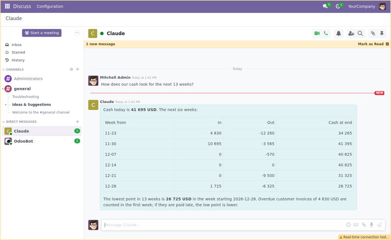

======================================
AI Connection Discuss Bot - Accounting
======================================

.. 
   !!!!!!!!!!!!!!!!!!!!!!!!!!!!!!!!!!!!!!!!!!!!!!!!!!!!
   !! This file is generated by oca-gen-addon-readme !!
   !! changes will be overwritten.                   !!
   !!!!!!!!!!!!!!!!!!!!!!!!!!!!!!!!!!!!!!!!!!!!!!!!!!!!
   !! source digest: sha256:10136177d73ca79b93391d4b60de35810d7b5bde4a63ec76f8af2a44d7190400
   !!!!!!!!!!!!!!!!!!!!!!!!!!!!!!!!!!!!!!!!!!!!!!!!!!!!

.. |badge1| image:: https://img.shields.io/badge/maturity-Beta-yellow.png
    :target: https://odoo-community.org/page/development-status
    :alt: Beta
.. |badge2| image:: https://img.shields.io/badge/license-AGPL--3-blue.png
    :target: http://www.gnu.org/licenses/agpl-3.0-standalone.html
    :alt: License: AGPL-3
.. |badge3| image:: https://img.shields.io/badge/github-Cetmix--Nordic--Ltd%2Fai--demo-lightgray.png?logo=github
    :target: https://github.com/Cetmix-Nordic-Ltd/ai-demo/tree/18.0/ai_connection_discuss_bot_account
    :alt: Cetmix-Nordic-Ltd/ai-demo

|badge1| |badge2| |badge3|

Finance tools for the AI bot of ``ai_connection_discuss_bot``. The bot
answers questions about the company's cash flow with figures computed by
Odoo; the AI only explains them.

+------------------------+--------------------------------------------+
| Tool                   | Answers                                    |
+========================+============================================+
| ``cash_flow_forecast`` | Opening cash, money in and out per week or |
|                        | month by category, overdue items, running  |
|                        | balance and the lowest point. Optionally   |
|                        | "realistic": open customer invoices moved  |
|                        | by each customer's average payment delay.  |
+------------------------+--------------------------------------------+
| ``cash_flow_history``  | Actual cash flow statement per month from  |
|                        | the bank and cash accounts, by category:   |
|                        | customers, suppliers, taxes, wages and     |
|                        | other liabilities, other operating,        |
|                        | investments, financing. Internal transfers |
|                        | are left out.                              |
+------------------------+--------------------------------------------+

The forecast uses open invoices and bills and the forecast lines of
``mis_builder_cash_flow`` (``mis_builder_cash_flow_auto`` and its sales,
purchase and contract modules generate them).

Like all tools of the bot, they run with the access rights of the user
who asked: a user who cannot read journal items gets no figures.

**Table of contents**

.. contents::
   :local:

Configuration
=============

Installing the module adds the two tools to the default bot (*Claude*).
For another bot, add *cash_flow_forecast* and *cash_flow_history* to its
*AI Bot Tools* (*Settings > Users > the bot > AI Bot*).

Set up the forecast sources as described in
``mis_builder_cash_flow_auto`` (recurring costs, VAT). Bank and cash
accounts with *Hide in Cash Flow* are left out of both tools.

Usage
=====

Ask the bot in Discuss, for example:

-  *What does our cash look like for the next 13 weeks?*
-  *When is our cash at its lowest in the coming 12 months, and why?*
-  *Make the forecast realistic: how late do our customers pay?*
-  *Show the cash flow statement of the past 6 months. Where did the
   money go?*

Known issues / Roadmap
======================

-  Financing and investments are recognised from account types only;
   short-term loans on current liability accounts are counted with wages
   and other liabilities.
-  The realistic forecast moves customer invoices only, not the forecast
   lines of sales orders and contracts.

Changelog
=========

Bug Tracker
===========

Bugs are tracked on `GitHub Issues <https://github.com/Cetmix-Nordic-Ltd/ai-demo/issues>`_.
In case of trouble, please check there if your issue has already been reported.
If you spotted it first, help us to smash it by providing a detailed and welcomed
`feedback <https://github.com/Cetmix-Nordic-Ltd/ai-demo/issues/new?body=module:%20ai_connection_discuss_bot_account%0Aversion:%2018.0%0A%0A**Steps%20to%20reproduce**%0A-%20...%0A%0A**Current%20behavior**%0A%0A**Expected%20behavior**>`_.

Do not contact contributors directly about support or help with technical issues.

Credits
=======

Authors
-------

* Cetmix Nordic Ltd

Contributors
------------

-  `Cetmix <https://cetmix.fi>`__:

   -  Jussi Lehto

Maintainers
-----------

This module is part of the `Cetmix-Nordic-Ltd/ai-demo <https://github.com/Cetmix-Nordic-Ltd/ai-demo/tree/18.0/ai_connection_discuss_bot_account>`_ project on GitHub.

You are welcome to contribute.
